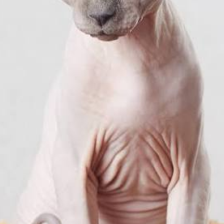

# Corrections humaines et amélioration progressive d'IAnimaux

## Corriger une photo dans l'application

Après avoir lancé la classification :

1. Ouvrir **Corriger ou confirmer une photo**, sous le tableau des résultats.
2. Sélectionner la photo à vérifier.
3. Choisir **Chat** ou **Chien** dans **Catégorie correcte**.
4. Ajouter éventuellement un commentaire, par exemple « Sphynx ».
5. Cliquer sur **Enregistrer la correction**.

La photo et son étiquette humaine sont conservées localement pour préparer un
réentraînement. La correction ajuste le lot en cours. Une nouvelle classification
repart des prédictions du modèle : une ancienne annotation ne remplace plus sa
sortie automatiquement. Cette décision correspond au refuge, qui traite surtout
des photos nouvelles.

Le tableau distingue **Prédiction IA**, **Confiance IA**, **Catégorie retenue** et
**Origine**. Les compteurs suivent la catégorie retenue. La correction n'attribue
pas une confiance artificielle de 100 % et ne modifie pas les scores du réseau.
Les fichiers aux octets identiques partagent la même annotation enregistrée,
même s'ils ont des noms différents. Deux photos différentes de même nom restent
distinctes. L'annotation historique peut préremplir le formulaire sans changer
la catégorie automatiquement retenue pour un nouveau lot.

Le commentaire de race est une annotation libre. Le modèle continue de prédire
uniquement Chat ou Chien ; il ne devient pas un classificateur de races.

## Trois mécanismes à distinguer

| Mécanisme | Effet | État actuel |
|---|---|---|
| Correction du résultat | Une personne valide la catégorie retenue | Implémenté |
| Historique d'annotation | Une étiquette et sa provenance restent consultables | Persistant, sans remplacement des nouvelles prédictions |
| Réentraînement supervisé | Les poids sont ajustés avec de nouveaux exemples | Disponible explicitement, avec comparaison des modèles |

La correction est une **annotation supervisée fournie par une personne**.
Pour améliorer la reconnaissance de nouveaux sphynx, il faut réunir des
exemples variés, examiner leurs étiquettes et entraîner une nouvelle version du
modèle avec les données d'origine et les nouveaux exemples autorisés. Les essais
sont décrits dans [la fiche de réentraînement](reentrainement_generalisation.md). Le tutoriel
officiel [PyTorch sur l'apprentissage par transfert](https://docs.pytorch.org/tutorials/beginner/transfer_learning_tutorial.html)
illustre la distinction entre extracteur gelé et paramètres entraînés.

Une seule correction ne garantit pas une amélioration sur d'autres photos. La
nouvelle version devra être comparée sur la validation sans reprendre ses images
comme exemples d'entraînement. Le test officiel reste réservé à l'évaluation finale.

## Analyse du cas du sphynx

La personne responsable du projet a signalé une erreur sur les 19 photos essayées
dans `vraies photos/`. Ce retour constitue une observation exploratoire ; les
19 photos n'ont pas été converties en un ensemble de test indépendant annoté.

L'erreur sur `images (15).jpeg` a été reproduite avec le checkpoint `first_run` :

| Élément | Résultat |
|---|---|
| Catégorie indiquée par la personne | Chat, sphynx |
| Prédiction brute du modèle | Chien |
| Score Chien | 54,07 % |
| Score Chat | 45,93 % |
| Dimensions originales | 316 × 632 pixels |
| Sphynx déjà présents dans l'entraînement Oxford | 80 |
| Sphynx dans la validation Oxford | 20 |

Le réseau a donc déjà rencontré des sphynx, sans réussir cette photo particulière.
Sur ce portrait vertical, le recadrage central 224 × 224 retire les yeux et les
oreilles et conserve surtout le corps :



Cette perte d'information est un facteur plausible, pas une cause unique
démontrée expérimentalement. Une variante préservant le cadrage complet a été
entraînée et comparée : elle reconnaît 19 des 20 sphynx de validation, mais son
exactitude globale est inférieure à la référence. Elle n'a donc pas été activée.

La catégorie Chat confirmée dans la conversation a été enregistrée avec un
commentaire Sphynx. Le diagnostic est dans
[diagnostic_sphynx.json](../results/corrections/diagnostic_sphynx.json).
Le diagnostic décrit le modèle initial, dont la sortie brute est Chien à 54,07 %.
Une correction humaine ne constitue pas un succès du réseau ; une réussite
après utilisation de la photo pour entraîner ne mesure pas non plus une
généralisation sur une image inconnue.

## Stockage et traçabilité

`ianimaux/feedback.py` utilise SQLite, inclus dans Python, sans bibliothèque
supplémentaire. La base est située dans
`data/feedback/corrections.sqlite3`, un dossier exclu de Git.

La table `corrections` conserve une entrée par empreinte SHA-256 de fichier :
octets originaux, nom, empreinte de pixels, catégorie humaine, commentaire,
prédiction et score du modèle, empreinte du checkpoint, origine connue et dates.
Une nouvelle correction met à jour l'entrée sans multiplier les copies de photo.
La table `correction_events` garde l'historique des validations, sans recopier
les octets de l'image à chaque événement.

Le modèle est identifié par son empreinte SHA-256. Les tests vérifient que son
fichier reste inchangé après l'enregistrement d'une correction. Le stockage
permet de retrouver les corrections après redémarrage de l'application.

Les photos simplement importées restent en mémoire comme auparavant. Seules
les photos explicitement corrigées ou confirmées sont conservées dans la base.

## Protection des partitions et export

Avant de préparer une photo comme nouvel exemple, le code compare ses empreintes
de fichier et de pixels RGB orientés aux partitions sauvegardées. Une photo déjà
présente dans l'entraînement, la validation ou le test Oxford reste mémorisable
pour l'interface, mais est exclue des nouveaux exemples externes. Si les listes
de partitions sont absentes, son origine est considérée comme non vérifiée et
l'export d'entraînement est également exclu.

La protection porte sur les fichiers et pixels exacts ; elle ne détecte pas
toutes les images proches, recadrées ou recompressées avec perte. Une inspection
des nouveaux exemples reste donc nécessaire avant leur utilisation.

Pour créer un instantané des corrections externes autorisées :

```bash
source .venv/bin/activate
python scripts/export_feedback.py --output-dir data/feedback/export_02
```

Un premier instantané `export_01` a été créé pour la correction du sphynx.
Chaque export contient :

- `images/` : copies inchangées nommées avec leurs empreintes, sans utiliser les noms importés comme chemins.
- `train.csv` : catégories humaines et cibles 0/1, chemins relatifs et provenance.
- `summary.json` : nombres exportés et exclus, motifs et absence de réentraînement.

L'export revérifie les partitions actuelles et refuse d'écraser un dossier existant.
Ce manifeste est consommé uniquement avec l'option explicite
**`scripts/train.py --feedback-dir <dossier_export>`**, jamais au simple lancement
de Streamlit. Les photos retenues pour un réentraînement doivent être
déclarées comme données de développement et ne pourront plus servir à mesurer
une performance sur des exemples jamais vus.

## Vérifications réalisées

Les contrôles couvrent la persistance,
l'historique, l'absence de modification des scores et poids, le refus d'une
étiquette ou photo incohérente, la protection de la validation malgré un nom ou
encodage différent aux pixels identiques, les exports sans écrasement et le
parcours complet entre deux sessions : l'annotation persiste, mais ne remplace
pas une nouvelle prédiction.

Le premier prototype réappliquait la correction au même fichier. Ce fonctionnement
a été retiré après clarification du besoin métier. Les réentraînements sont
séparés et documentés dans `reentrainement_generalisation.md`.

## Ce que je dois pouvoir expliquer au professeur

- Pourquoi mémoriser une correction ne signifie-t-il pas apprendre à généraliser ?
- Quelle différence entre une prédiction automatique et une annotation humaine ?
- Pourquoi conserver la prédiction initiale et la version du modèle ?
- Comment préparer de nouvelles données sans contaminer la validation et le test ?
- Comment un recadrage peut-il retirer des indices utiles à la classification ?
