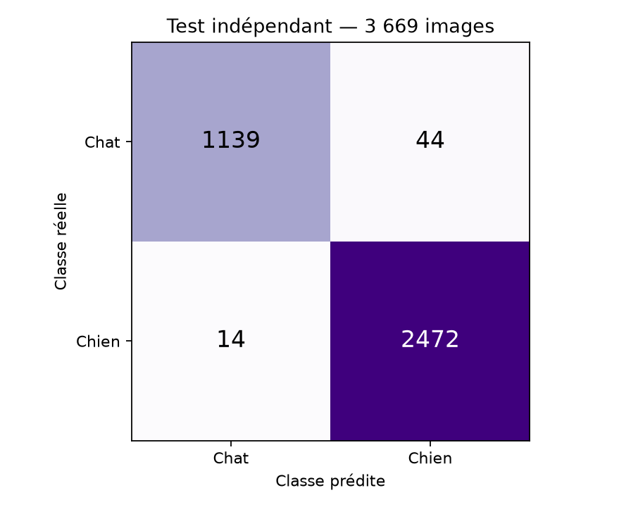
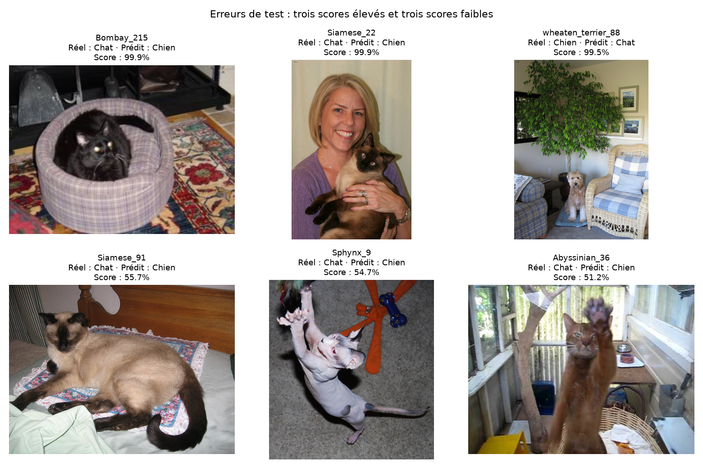

# Évaluation finale d'IAnimaux — 21 novembre 2026

## Protocole exécuté

La copie gelée **binary_final_v1** (`refined_feedback_v1`, époque 3) a été
évaluée sur les **3 669 images du test officiel Oxford-IIIT Pet**, après vérification
des empreintes du modèle, des sources, des partitions et de chaque fichier image.
Le modèle n'a pas été réentraîné ni sélectionné sur ces résultats. Les corrections
humaines et les annotations historiques ne sont jamais appliquées aux prédictions
du test. Le prétraitement est celui fixé avant l'évaluation : conversion RGB,
orientation EXIF, redimensionnement 256, recadrage central 224 et normalisation
ImageNet. Exécution CPU, 4 threads, lots de 32, sans augmentation et sans mélange,
`eval` et `torch.inference_mode`. La décision suit l'argmax, sans seuil de rejet.

La référence est **toujours prédire Chien**, classe majoritaire déterminée sur
l'entraînement. Les classes du test sont 1 183 chats et 2 486 chiens. Les sorties
restent binaires : le tableau descriptif par race ne reconnaît pas les races.

## Résultats réels du test indépendant

| Mesure | MobileNetV3 Small adapté | Référence toujours Chien |
| --- | --- | --- |
| Exactitude | 98,42 % | 67,76 % |
| F1 macro | 98,18 % | 40,39 % |

**3 611 images correctement classées sur 3 669**, soit **58 erreurs**.
La perte moyenne par entropie croisée est **0,04269**.
L'évaluation par lots (lecture, prétraitement et inférence, hors vérification
initiale des fichiers et création des figures) a duré **138,1 secondes** sur cette machine. Ce temps ne mesure pas la latence de l'application
Streamlit déployée et n'est pas une garantie de vitesse sur un autre serveur.

| Classe | Précision | Rappel | F1 | Effectif réel |
| --- | --- | --- | --- | --- |
| Chat | 98,79 % | 96,28 % | 97,52 % | 1183 |
| Chien | 98,25 % | 99,44 % | 98,84 % | 2486 |

La matrice de confusion se lit par ligne (classe réelle), puis par colonne
(classe prédite) :

| Réel / Prédit | Chat | Chien |
| --- | --- | --- |
| Chat | 1139 | 44 |
| Chien | 14 | 2472 |

## Comprendre les calculs à partir de nos résultats

En considérant Chat comme la classe positive :

- VP = 1139 : chats reconnus comme chats.
- FN = 44 : chats classés comme chiens.
- FP = 14 : chiens classés comme chats.
- VN = 2472 : chiens reconnus comme chiens.

L'exactitude est `(1139 + 2472) / 3669 = 98,42 %`.
La précision Chat est `1139 / (1139 + 14) = 98,79 %` :
parmi les prédictions Chat, quelle proportion est correcte ?
Le rappel Chat est `1139 / (1139 + 44) = 96,28 %` :
parmi les vrais chats, quelle proportion est retrouvée ?
Le F1 combine précision et rappel avec `2PR / (P + R)`.
Le F1 macro fait la moyenne des F1 Chat et Chien et donne le même poids aux deux
classes, même si les chiens sont plus nombreux. Ces calculs utilisent les
résultats réels, contrairement aux exemples artificiels de pédagogie antérieurs.

## Interprétation et limites

L'écart d'exactitude avec la référence majoritaire est de
**30,66 points de pourcentage**.
Cette référence montre l'intérêt de dépasser une décision triviale ; elle ne
constitue pas une comparaison avec un autre modèle d'apprentissage automatique.
Les résultats de validation connus sont 99,05 % d'exactitude et 98,91 % de F1
macro ; les mesures ci-dessus concernent un ensemble différent qui n'a pas servi
à choisir le modèle. Une différence entre validation et test est normale et ne
prouve pas à elle seule une cause précise.

Le fichier `erreurs.csv` liste toutes les erreurs, triées par score décroissant.
La planche suivante montre trois erreurs aux scores les plus élevés et trois aux
scores les plus faibles. Cette sélection illustre des comportements ; elle n'est
pas un échantillon représentatif de toutes les erreurs. Les images présentées
sont les originaux, alors que le réseau reçoit un recadrage central.

Les exemples donnent des observations concrètes à discuter :

- `Bombay_215` : le chat noir dans son panier est classé Chien avec 99,9 % de
  confiance. Une erreur peut donc être très confiante, même lorsque l'animal est
  identifiable pour un humain.
- `Siamese_22` : une personne tient le chat ; cette composition diffère d'un
  portrait centré sur l'animal. Le score Chien est également de 99,9 %.
- `wheaten_terrier_88` : le chien occupe une petite partie du bas de l'image,
  avec beaucoup de mobilier et de végétation autour. C'est une piste pour
  discuter de la place de l'animal et du recadrage, sans en établir la cause.
- `Sphynx_9` : le chat est debout dans une pose inhabituelle ; le score Chien
  n'est que de 54,7 %, ce qui indique une préférence faible entre les sorties.

Le rappel des chats est plus faible que celui des chiens : 96,28 % contre
99,44 %. L'exactitude globale seule masque cette différence. Le sous-groupe
annoté Sphynx contient 100 images de test, dont 94 classées Chat : cela mesure
la classification d'espèce, pas une reconnaissance de race. Aucun modèle
alternatif n'a été évalué sur ce test pour attribuer causalement ce résultat à
l'exemple humain ajouté pendant le réentraînement.

Un score softmax élevé peut accompagner une erreur : il mesure la préférence du
modèle parmi les deux sorties, sans garantir sa justesse. Le cadrage et la petite
taille de l'animal peuvent être des pistes d'analyse visuelle, mais une photo
isolée ne prouve pas la cause d'une erreur. L'application n'a pas appris à rejeter
les images sans chat ou chien et ne reconnaît pas les races. Les animaux multiples,
les occultations et les photos très différentes du jeu Oxford restent des limites.

Le test officiel appartient au même jeu de données que l'entraînement. Il ne
mesure pas directement les performances sur les photos réelles d'un refuge.
Une évaluation externe annotée serait un prolongement utile. Les images du test
sont désormais consultées : il faut conserver ces résultats et éviter d'ajuster
le modèle sur leurs erreurs en présentant ensuite le même test comme indépendant.

## Traçabilité et fichiers

Les résultats sont dans `results/evaluation/binary_final_v1/test_results/` :

- `summary.json` : métriques, matrice et informations d'exécution.
- `predictions.csv` : une ligne par image, cible, prédiction et deux scores.
- `mesures_par_classe.csv`, `matrice_confusion.csv` et la figure associée.
- `erreurs.csv`, `exemples_erreurs.csv` et la planche d'exemples.
- `classification_binaire_par_race.csv` : description des sous-groupes annotés.
- `execution.json` : protocole, empreintes du script, du manifeste et des sorties.

`scripts/evaluate_final.py` a réalisé cette exécution et refuse d'écraser les
résultats existants. Il n'est pas nécessaire de le relancer pour consulter les
résultats. Le manifeste de gel est conservé tel quel : sa mention d'absence
d'inférence décrit l'état au moment du gel, avant cette évaluation.

Les contrôles automatisés couvrent les calculs manuels sur un exemple connu,
les scores invalides, les doublons, les égalités, puis la couverture exacte du
test, l'accord entre matrice et prédictions et les empreintes des résultats.
**55 tests passent** dans le projet après cette étape.

## Travail restant et participation de l'étudiante

Aucune manipulation n'était nécessaire pendant l'évaluation. Pour préparer la
suite, lire la matrice et expliquer les deux types d'erreurs avec ses propres
mots ; examiner les exemples sans supposer que leur score est une certitude.
Préparer aussi quelques photos externes pour une démonstration, en distinguant
ces exemples des mesures quantitatives sur le test officiel.

Les prochaines étapes sont de rédiger le rapport final de **10 pages maximum,
références comprises**, préparer l'explication orale des techniques et calculs,
vérifier l'installation et constituer l'archive Moodle. Le rapport technique
actuel est un journal détaillé et devra être condensé selon le plan imposé.
