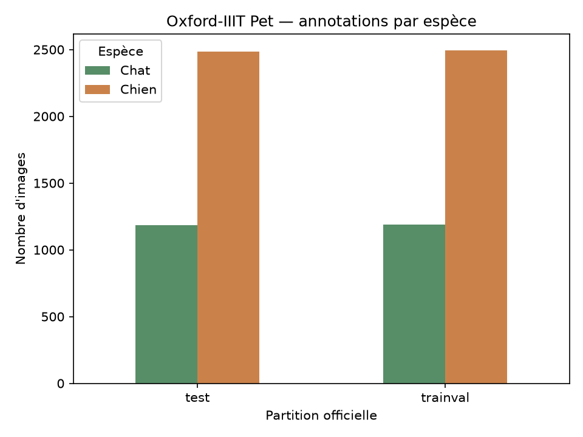
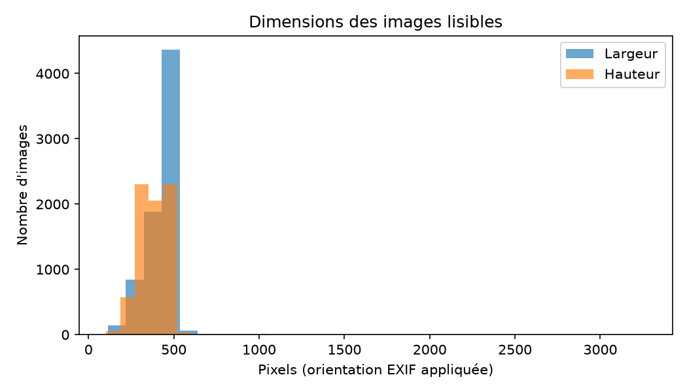
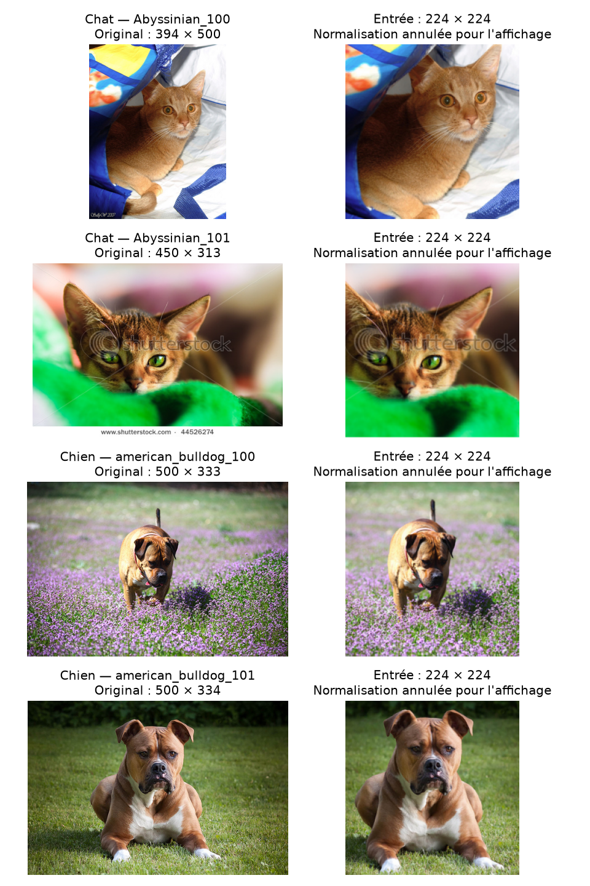
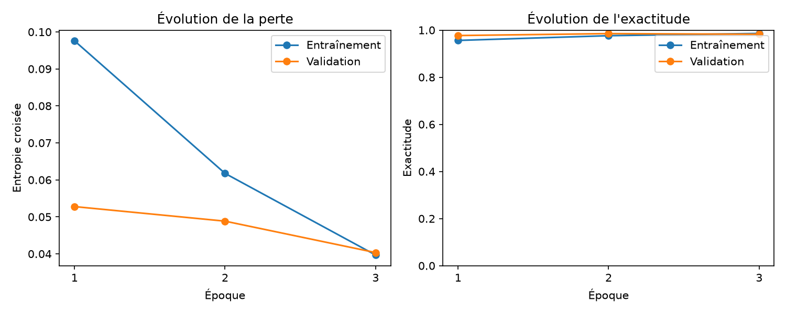
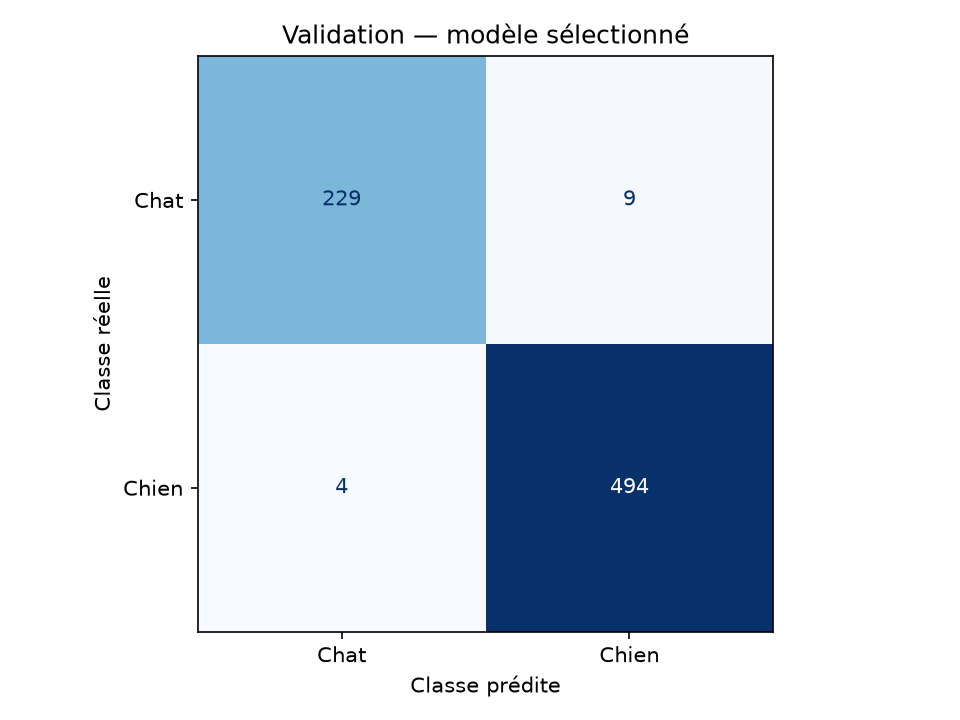
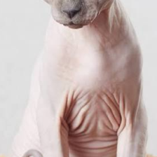

# Rapport technique IAnimaux

**Système intelligent de classification automatique de photos d’animaux**  
**Cours :** INF1853 — Introduction à l’intelligence artificielle, UQO  
**Session :** automne 2026  
**Organisation :** projet individuel  
**Date de l’état d’avancement :** 21 novembre 2026<br>
**Version :** 1.9 — Évaluation finale du modèle binaire réalisée<br>
**Remise :** 8 décembre 2026 — **Présentation :** 9 décembre 2026

## Résumé

**État au 21 novembre 2026 :** le prototype binaire est fonctionnel et son
évaluation finale est réalisée : **98,42 % d'exactitude et 98,18 % de F1 macro**
sur 3 669 images de test (58 erreurs). Les sections précédentes retracent les
étapes de développement ; les résultats finaux figurent en section 20.


IAnimaux vise à automatiser le classement de photographies de chats et de chiens
pour un refuge animalier. L’application prévue utilisera un réseau de neurones
convolutif MobileNetV3 Small, adapté par apprentissage par transfert, et une
interface Streamlit permettant de télécharger les photographies classées.

Les travaux réalisés comprennent le cadrage du projet, la préparation de
l’environnement Python, la création d’une structure modulaire, un écran d’accueil,
le téléchargement d’Oxford-IIIT Pet et l’audit des images annotées. Les 7 349 images
référencées dans les partitions officielles sont lisibles. Elles représentent
2 371 chats et 4 978 chiens, répartis entre 37 races. Aucun doublon exact de pixels
n’a été détecté. Des tableaux, des graphiques et des exemples de normalisation ont
été produits à partir des données réelles.

Les partitions sont maintenant sauvegardées : 2 944 images d’entraînement,
736 de validation et 3 669 de test. Le chargement par lots a été contrôlé et
47 tests passent. Un premier entraînement de trois époques est terminé en
6 min 44 s sur CPU. Le modèle sélectionné selon la perte de validation atteint
98,23 % d’exactitude et 97,97 % de F1 macro sur les 736 images de validation.
Le checkpoint a été sauvegardé et son rechargement vérifié. Ces mesures servent
au développement ; le test officiel n’a pas encore été utilisé. L’importation
multiple et la prédiction sont maintenant intégrées dans Streamlit, avec scores,
tableau, compteurs, aperçus et gestion des fichiers illisibles. La
fonctionnalité de téléchargement ZIP organise maintenant les copies dans deux
dossiers, `chat/` et `chien/`. Un mécanisme
de correction humaine a également été ajouté après l'analyse d'une erreur sur
un chat sphynx. Les annotations ajustent le lot courant et alimentent des
réentraînements explicites ; elles ne remplacent plus automatiquement les
prédictions d'une nouvelle importation. Les expériences sont conservées séparément.

Le modèle actif après comparaison est désormais `refined_feedback_v1` :
**99,05 % d'exactitude et 98,91 % de F1 macro sur la validation globale**,
avec **18 sphynx reconnus sur 20**, contre 17 pour la référence. Le test final
reste réservé. Le premier modèle et l'expérience non retenue sont conservés.

## 1. Problématique et exigences

### 1.1 Besoin visé

Les refuges peuvent recevoir de nombreuses photographies mélangées de chats et de
chiens. Leur classement manuel constitue une tâche répétitive. IAnimaux doit
permettre l’importation d’un lot d’images, prédire l’espèce de l’animal principal,
afficher la catégorie et un score de confiance, puis fournir une archive ZIP
organisée dans des dossiers `Chats/` et `Chiens/`.

Les photographies originales doivent être préservées. Les noms de sortie devront
éviter les écrasements. La gestion des fichiers illisibles et des prédictions
incertaines fait partie du fonctionnement prévu ; un dossier `A_verifier/` pourra
être utilisé. Une photographie contenant un animal principal constitue le cas
d’utilisation initial. La détection de plusieurs animaux est hors périmètre.

### 1.2 Cadre académique et priorités

Le document [CONTEXT.md](../CONTEXT.md) constitue la référence principale du
projet. Il a été actualisé pour refléter un travail réalisé par une seule personne.
Le produit, initialement appelé RefugeIA, porte désormais le nom **IAnimaux**.
Le renommage a été appliqué à l’interface, aux documents, au script de vérification
et au module Python, maintenant nommé `ianimaux`.

Les priorités retenues sont :

1. Obtenir un modèle chats/chiens fonctionnel.
2. Intégrer les prédictions à une interface et produire le classement ZIP.
3. Évaluer le modèle de manière rigoureuse et reproductible.
4. Finaliser la documentation, le rapport et la démonstration.
5. Envisager les races seulement si les objectifs obligatoires sont terminés.

Le rapport académique final devra respecter une limite de **10 pages, références
comprises**. Le présent rapport constitue un état technique intermédiaire ; il
servira de matière à la rédaction finale, qui intégrera les expériences futures.
Les critères du cours donnent notamment du poids à la méthodologie et à
l’implémentation (25 %), aux résultats et à leur analyse (20 %), ainsi qu’à la
présentation et à la démonstration (20 %).

## 2. Choix techniques et architecture

### 2.1 Technologies retenues

Python a été retenu pour son écosystème de vision par ordinateur et
d’apprentissage automatique. Weka a été considéré, mais n’est pas une dépendance
du projet. L’application est locale, sans API externe de classification ni
serveur d’application séparé. Une base SQLite embarquée a été ajoutée pour
les corrections humaines, sans service de base de données à administrer.

| Composant | Rôle | Version installée |
|---|---|---|
| Python | Langage et environnement | 3.11.18 |
| PyTorch | Tenseurs, réseaux et entraînement | 2.15.0 |
| Torchvision | MobileNetV3, jeu de données et transformations | 0.29.2 |
| Streamlit | Interface graphique locale | 1.67.0 |
| Pillow | Lecture et conversion des images | 13.0.0 |
| scikit-learn | Future séparation stratifiée et métriques | 1.9.1 |
| Matplotlib | Figures d’exploration | 3.11.2 |
| Pandas | Manifestes, tableaux et fichiers CSV | 3.1.1 |
| SQLite via `sqlite3` | Corrections et historique locaux | Inclus dans Python |

Les dépendances directes figurent dans [requirements.txt](../requirements.txt).
L’ensemble des versions installées, y compris les dépendances indirectes, est
consigné dans [requirements-lock.txt](../requirements-lock.txt). Cette référence
correspond à l’installation de développement sur macOS ARM64 ; sa compatibilité
avec un autre système devra être vérifiée.

### 2.2 Séparation des responsabilités

Quatre composantes ont été définies : préparation des données, modèle d’IA,
classification et organisation des fichiers, puis interface utilisateur.
L’entraînement sera séparé de l’utilisation : l’application chargera des poids
sauvegardés plutôt que de réentraîner le modèle à chaque lancement.

```text
Parcours de développement prévu
Données annotées → préparation → entraînement → validation → modèle sauvegardé
                                                         → test final indépendant

Parcours utilisateur prévu
Photos importées → prétraitement → modèle sauvegardé → prédictions
                → résultats et statistiques → téléchargement ZIP
```

À ce jour, la lecture, l’audit, la séparation et le chargement des données sont
implémentés. Le prétraitement est illustré sur des exemples et les augmentations
sont réservées à l’entraînement. L’interface permet maintenant l’importation
multiple et les prédictions réelles. L’organisation des copies et l’export ZIP
sont maintenant implémentés en mémoire au clic sur le bouton de téléchargement.

### 2.3 Organisation du dépôt

```text
IAnimaux/
├── CONTEXT.md
├── README.md
├── requirements.txt
├── requirements-lock.txt
├── .gitignore
├── config.py
├── app.py
├── ianimaux/
│   ├── __init__.py
│   ├── data.py
│   ├── datasets.py
│   ├── model.py
│   ├── training.py
│   ├── predict.py
│   └── feedback.py
├── scripts/
│   ├── check_environment.py
│   ├── prepare_data.py
│   ├── create_splits.py
│   ├── check_dataloaders.py
│   ├── train.py
│   ├── explain_learning.py
│   └── export_feedback.py
├── tests/
│   ├── test_data.py
│   ├── test_splits.py
│   ├── test_datasets.py
│   ├── test_training.py
│   ├── test_predict.py
│   ├── test_app.py
│   └── test_feedback.py
├── data/oxford-iiit-pet/       # Archives et données locales
├── results/
│   ├── exploration/          # Tableaux, rapport et figures
│   ├── splits/               # Partitions, paramètres et contrôles des lots
│   ├── training/first_run/   # Historique, métriques et figures de validation
│   ├── pedagogie/           # Calculs illustratifs séparés
│   └── interface/           # Vérification de cohérence de l’inférence
├── docs/                     # Documents techniques et pédagogiques
├── models/first_run/         # Checkpoint binaire entraîné
└── notebooks/                # Réservé aux futurs calculs pédagogiques
```

Un dépôt Git local a été initialisé. `.gitignore` exclut l’environnement virtuel,
les caches, les données et les poids de modèles. Le modèle local est dans
`models/first_run/best_model.pt` ; `notebooks/` reste réservé à un futur carnet.
La remise devra fournir les ressources nécessaires à la démonstration.

## 3. Environnement de développement réalisé

L’ordinateur disposait initialement de Python 3.9.6. Python 3.11 a été installé
avec Homebrew, puis un environnement virtuel `.venv` a été créé dans le projet.
Les bibliothèques ont été installées dans cet environnement pour isoler leurs
versions des autres projets.

Le script [check_environment.py](../scripts/check_environment.py) contrôle la
version de Python, importe les sept bibliothèques directes et affiche leurs
versions. Il vérifie également un calcul PyTorch sur CPU :

```text
(1 × 2) + (2 × 2) + (3 × 2) = 12
```

Un MobileNetV3 Small est ensuite construit avec `weights=None`, placé en mode
évaluation, puis exécuté sous `torch.inference_mode()` sur un tenseur nul de
dimensions `(1, 3, 224, 224)`. La sortie attendue est `(1, 1000)`, correspondant
à l’architecture originale. Les poids sont aléatoires : ce contrôle confirme
l’exécution technique du réseau et la compatibilité PyTorch/Torchvision, sans
évaluer une capacité à reconnaître des animaux.

Les imports, le calcul CPU, le passage dans le réseau et `pip check` ont réussi.
L’accélération MPS n’était pas disponible dans l’environnement d’exécution du
contrôle ; le CPU est opérationnel. Ces contrôles initiaux ne téléchargent aucun
poids pré-entraîné ; les poids ImageNet ont été téléchargés ensuite à l’étape 4.

## 4. Acquisition et lecture des données

### 4.1 Source et périmètre de l’audit

Le jeu retenu est **Oxford-IIIT Pet**, publié par Parkhi et ses collaborateurs
[1]. Les archives officielles des images et des annotations ont été téléchargées
avec Torchvision, qui vérifie leurs empreintes MD5. Le téléchargement des
annotations a été interrompu, puis relancé et terminé avant l’audit complet.

Le dossier local contient **7 390 fichiers portant l’extension `.jpg`**.
Les listes officielles `trainval.txt` et `test.txt` référencent **7 349 images**.
Les 41 autres JPEG ne font pas partie du périmètre d’analyse retenu. Ils ne sont
pas comptés comme fichiers illisibles et ne sont pas ajoutés aux partitions.

Les annotations de segmentation et de localisation fournies par la source ne
sont pas utilisées pour la classification binaire actuelle.

### 4.2 Interprétation des annotations

Chaque ligne officielle contient quatre champs :

```text
identifiant_image    identifiant_classe    espece    identifiant_race_dans_espece
```

Le module [data.py](../ianimaux/data.py) lit les deux listes officielles, conserve
les identifiants d’origine et construit un tableau exploitable avec Pandas.
L’espèce provient de l’annotation, pas de la capitalisation du nom de fichier.

| Espèce | Code officiel | Cible prévue du modèle |
|---|---:|---:|
| Chat | 1 | 0 |
| Chien | 2 | 1 |

La race est identifiée à partir du nom de fichier, associé à son identifiant
de classe officiel. Ces informations sont conservées pour explorer les données
et permettre une future stratification ; elles ne constituent pas un modèle de
reconnaissance des races.

Les contrôles portent sur le format des lignes et des identifiants, les valeurs
des étiquettes, l’unicité des identifiants entre les deux partitions et la
cohérence des correspondances entre classe, race et espèce. Une incohérence
bloquante déclenche une erreur explicite.

## 5. Audit des images et des doublons

Pour chaque image annotée, le script calcule une empreinte SHA-256 du fichier,
effectue une vérification Pillow, puis rouvre et décode complètement l’image.
Il enregistre le mode de couleur initial, applique l’orientation EXIF et convertit
l’image en RGB. Les dimensions relevées correspondent à cette orientation.

Une seconde empreinte SHA-256 porte sur les pixels RGB décodés et leurs
dimensions. Elle permet de repérer des fichiers dont les pixels sont identiques,
même si la compression ou les métadonnées diffèrent sans modifier ces pixels.
La recherche vérifie aussi si un groupe de doublons traverse `trainval` et `test`.

Un fichier absent ou illisible est signalé dans un rapport d’erreurs plutôt que
de disparaître silencieusement de l’analyse. Les photographies originales ne
sont jamais réécrites par l’audit.

**Résultat :** les 7 349 images annotées ont été entièrement décodées. Aucune
image absente ou illisible et aucun groupe de doublons exacts de pixels n’ont
été détectés. Cette méthode ne recherche pas les images presque identiques,
recadrées ou recompressées avec perte ; elle ne prouve donc pas l’absence de
toute similarité entre partitions.

## 6. Résultats descriptifs obtenus

Les valeurs suivantes proviennent de
[summary.json](../results/exploration/summary.json), des tableaux d’effectifs et
du manifeste produit par l’exploration.

### 6.1 Répartition des espèces

| Partition officielle | Chats | Chiens | Total |
|---|---:|---:|---:|
| `trainval` | 1 188 | 2 492 | 3 680 |
| `test` | 1 183 | 2 486 | 3 669 |
| **Total** | **2 371** | **4 978** | **7 349** |

Les chats représentent **32,26 %** des images annotées et les chiens **67,74 %**.
Le jeu couvre 12 races de chats et 25 races de chiens, soit 37 races au total.



*Figure 1 — Effectifs calculés à partir des annotations officielles.*

Cette répartition montre pourquoi l’exactitude seule sera insuffisante :
prédire systématiquement « Chien » donnerait arithmétiquement 67,74 % de bonnes
réponses sur l’ensemble annoté. Il s’agit d’une illustration du déséquilibre,
pas d’une mesure du futur modèle. La classe de référence sera déterminée sur
l’entraînement et la comparaison finale sera calculée sur le test réservé.
Les performances par classe et le F1 macro seront également nécessaires.

### 6.2 Dimensions et modes de couleur

| Statistique | Largeur en pixels | Hauteur en pixels |
|---|---:|---:|
| Minimum | 114 | 103 |
| Médiane | 500 | 375 |
| Maximum | 3 264 | 2 606 |

Les statistiques des deux colonnes sont calculées séparément : une largeur et
une hauteur d’une même ligne ne désignent pas nécessairement la même image.
Les modes relevés sont **7 346 images RGB** et **3 images RGBA**. La conversion
systématique en RGB prépare donc des entrées à trois canaux.



*Figure 2 — Distribution des largeurs et des hauteurs des images annotées lisibles.*

## 7. Prétraitement et calculs pédagogiques réalisés

Le prétraitement associé aux poids
`MobileNet_V3_Small_Weights.IMAGENET1K_V1` est utilisé sur des exemples issus de
`trainval` [2]. Obtenir ces transformations ne télécharge pas les poids du modèle.

Les opérations illustrées sont :

1. Appliquer l’orientation EXIF et convertir l’image en RGB.
2. Redimensionner le petit côté à 256 pixels en conservant les proportions.
3. Effectuer un recadrage central de 224 × 224 pixels.
4. Convertir les valeurs des pixels de l’intervalle 0–255 à l’intervalle 0–1.
5. Normaliser séparément les trois canaux.

L’image devient un tenseur de forme `(3, 224, 224)`. Pour chaque canal :

```text
x = pixel / 255
z = (x - moyenne) / écart_type
```

| Canal | Moyenne | Écart-type |
|---|---:|---:|
| Rouge | 0,485 | 0,229 |
| Vert | 0,456 | 0,224 |
| Bleu | 0,406 | 0,225 |

Ces constantes proviennent du prétraitement des poids ImageNet ; elles ne sont
pas calculées à partir de notre ensemble de test.

Un exemple réel est enregistré pour le canal rouge du pixel `(112, 112)` de
`Abyssinian_100`, après redimensionnement et recadrage :

```text
pixel rouge = 150
x = 150 / 255 ≈ 0,588235
z = (0,588235 - 0,485) / 0,229 ≈ 0,450809
```

La valeur enregistrée par PyTorch est environ 0,45080918. La petite différence
avec le calcul décimal provient de la précision numérique. Une valeur normalisée
peut être négative ; elle exprime une position par rapport à la moyenne du canal.



*Figure 3 — Exemples de `trainval`. La normalisation est annulée pour l’affichage
des images de droite. Photographies issues d’Oxford-IIIT Pet [1], droits conservés
par leurs propriétaires d’origine.*

Le recadrage central peut retirer une partie de l’animal : cette limite devra
être prise en compte dans l’analyse des erreurs. Les augmentations aléatoires
sont maintenant implémentées uniquement pour l’entraînement : recadrage aléatoire
de 224 × 224 après redimensionnement du petit côté à 256, puis retournement
horizontal de probabilité 0,5. Validation et test conservent le recadrage central.

## 8. Approche d’intelligence artificielle retenue

### 8.1 Apprentissage supervisé et CNN

Chaque photographie constitue une entrée et son espèce annotée constitue la
réponse attendue. Un CNN apprend des filtres capables de combiner des informations
locales, comme des contours et des textures, pour produire des représentations
utiles à la classification.

MobileNetV3 Small est le modèle de départ retenu pour limiter la complexité
d’exécution et permettre une utilisation sur un ordinateur personnel [2, 3].
Le contrôle technique du réseau original et son adaptation à deux classes sont
réalisés dans [model.py](../ianimaux/model.py).

### 8.2 Apprentissage par transfert implémenté

Le réseau est initialisé avec les poids officiels ImageNet
`MobileNet_V3_Small_Weights.IMAGENET1K_V1`, téléchargés dans `.cache/torch/`.
La dernière couche linéaire est remplacée par deux sorties, Chat et Chien.
Le bloc classificateur entier, composé de deux couches linéaires avec activation
Hardswish et dropout, est entraînable. Il compte 592 898 paramètres sur les
1 519 906 paramètres du modèle adapté. Les 927 008 paramètres de l’extracteur
restent gelés et ses couches BatchNorm restent en mode évaluation pour conserver
leurs statistiques internes.

La boucle dans [training.py](../ianimaux/training.py) utilise l’entropie croisée
sur les logits, la rétropropagation et Adam. Le softmax est appliqué séparément
pour obtenir les scores des prédictions. La validation est réalisée sans mise
à jour du modèle ; le checkpoint est sélectionné selon la perte de validation
minimale. Un ajustement partiel de l’extracteur restera facultatif.
Un score élevé ne garantit pas une prédiction correcte, notamment pour une
image sans chat ni chien.

### 8.3 Démonstrations pédagogiques disponibles

Les fiches expliquent la préparation, la normalisation, les partitions et
l’entraînement. [explain_learning.py](../scripts/explain_learning.py) exécute de
petits calculs de convolution, softmax, entropie croisée, gradient et métriques
sur une matrice artificielle. Le script vérifie notamment qu’un petit pas de
gradient diminue la perte illustrée. Les résultats pédagogiques sont séparés
dans `results/pedagogie/` et ne constituent pas des performances du modèle.
Le passage vers Adam et les poids réels du réseau est expliqué dans la
[fiche d’entraînement](entrainement_modele.md). Un carnet interactif pourra
reprendre ces calculs ultérieurement.

## 9. Interface et vérifications réalisées

### 9.1 Importation et résultats dans Streamlit

Le fichier [app.py](../app.py) affiche le titre **IAnimaux**, la zone
**Importer des photos** et le bouton **Lancer la classification**. Les formats
JPG/JPEG, PNG et WebP sont acceptés, dans une limite de 20 Mo par photo.
L’application affiche la progression, les compteurs de chats, chiens et fichiers
en erreur, un tableau des prédictions et scores, ainsi que des aperçus.

L’inférence dans [predict.py](../ianimaux/predict.py) utilise le checkpoint réel,
le prétraitement déterministe de validation, `model.eval()` et
`torch.inference_mode()`. Un fichier illisible produit une ligne d’erreur sans
interrompre les autres photos. Les originaux ne sont pas modifiés. Aucun seuil
de confiance arbitraire n’est appliqué. Les scores sont présentés comme des
indications du modèle, sans garantie de justesse.

Le modèle est conservé dans le cache de ressources Streamlit et les résultats
dans l’état de session. Une modification des noms ou contenus importés efface
les anciens résultats. Le contrôle `AppTest` couvre le parcours d’importation
et de classification. Le serveur a été démarré localement sur
`http://127.0.0.1:8501`. La revue visuelle a été effectuée dans Chrome sur
ordinateur et au format mobile lors de la refonte décrite à la section 17.
Le téléchargement ZIP est disponible après la classification et prend en compte
les corrections du lot courant, comme décrit à la section 18.

### 9.2 Tests d’intégrité

Les sept tests initiaux de [test_data.py](../tests/test_data.py) ont réussi :

| Contrôle | Comportement vérifié |
|---|---|
| Source de l’espèce | L’étiquette provient de l’annotation, indépendamment du nom |
| Identifiant répété | Une image présente dans les deux listes est refusée |
| Espèce contradictoire | Une classe associée à deux espèces est refusée |
| Espèce invalide | Une valeur hors des codes autorisés est refusée |
| Fichier corrompu ou absent | Une erreur exploitable est enregistrée |
| Copies aux pixels identiques | Elles sont détectées entre partitions sans modifier les fichiers |
| Absence de doublons | Un rapport vide exploitable est produit ; une image en niveaux de gris est lisible |

Les tests utilisent de petites données artificielles dans des dossiers
temporaires. Leur réussite valide les comportements du logiciel, pas la
performance de classification. L’audit complet constitue un contrôle distinct,
effectué sur les 7 349 photographies annotées réelles.

Neuf tests supplémentaires dans [test_splits.py](../tests/test_splits.py) et
[test_datasets.py](../tests/test_datasets.py) portent sur la stratification, la
conservation du test, la reproductibilité, le refus des anomalies, le chargement
RGB normalisé et la séparation des augmentations, soit un sous-total de
16 tests réussis pour la préparation des données. Trois tests supplémentaires
dans [test_training.py](../tests/test_training.py) vérifient le gel des poids et
statistiques de l’extracteur pendant une mise à jour, l’absence de modification
en validation et la restauration des mêmes logits après sauvegarde. Le total
pour les données et l’entraînement est de **19 tests réussis**. Cinq tests
d’inférence dans [test_predict.py](../tests/test_predict.py) et trois tests
d’interface dans [test_app.py](../tests/test_app.py) portent le total à
**27 tests réussis**. Ils vérifient notamment l’isolation d’un fichier corrompu,
les octets originaux inchangés, l’orientation EXIF, les noms répétés, la gestion
du modèle absent et le cycle de vie des résultats dans Streamlit.

## 10. Artefacts disponibles et reproduction

### 10.1 Fichiers produits par l’exploration

| Fichier dans `results/exploration/` | Contenu |
|---|---|
| `manifest.csv` | Identifiants, chemins relatifs, étiquettes, partitions, dimensions, modes, empreintes et erreurs |
| `summary.json` | Synthèse des effectifs et de l’audit |
| `images_invalides.csv` | Rapport d’images invalides, actuellement sans ligne de données |
| `doublons_exacts.csv` | Rapport de doublons exacts, actuellement sans ligne de données |
| `effectifs_especes.csv` | Effectifs par espèce et partition officielle |
| `effectifs_races.csv` | Effectifs par race, espèce et partition officielle |
| `effectifs_especes.png` | Graphique des effectifs |
| `dimensions_images.png` | Distribution des dimensions |
| `exemples_pretraitement.png` | Photos de `trainval` avant/après transformation |
| `exemples_normalisation.csv` | Valeurs réelles utilisées dans les calculs de pixels |
| `rapport_exploration.md` | Rapport généré automatiquement par le script |

La documentation complémentaire comprend le [README](../README.md), la
[démarche pédagogique](demarche_pedagogique.md) et la
[fiche de préparation des données](preparation_donnees.md).
La [fiche sur la séparation](separation_donnees.md) décrit la préparation des
partitions et les transformations utilisées pour chaque ensemble.

### 10.2 Commandes

Depuis la racine du projet, pour reproduire l’installation sur un Mac compatible :

```bash
python3.11 -m venv .venv
source .venv/bin/activate
python -m pip install -r requirements-lock.txt
python -m pip check
python scripts/check_environment.py
```

Pour télécharger les données si elles sont absentes, puis lancer l’audit :

```bash
python scripts/prepare_data.py --download
```

Les archives représentent environ 800 Mo compressés ; prévoir quelques Go
disponibles pour les archives et leur extraction. Lorsque les données sont
présentes, les commandes suivantes ne nécessitent pas leur téléchargement :

```bash
python scripts/prepare_data.py
python -m unittest discover -s tests -v
python -m streamlit run app.py
```

Le script d’exploration accepte également `--data-dir` et `--output-dir` pour
changer les emplacements. Il régénère ses fichiers de résultats ; les photos
sources restent préservées.

## 11. État fonctionnel et prochaines étapes

| Élément | État au 21 novembre 2026 |
|---|---|
| Cadrage, nom IAnimaux et périmètre individuel | Réalisé |
| Structure, dépôt Git local et environnement | Réalisé |
| Vérification CPU et exécution technique du réseau | Réalisée |
| Téléchargement des données et audit des annotations/images | Réalisé |
| Statistiques, figures et calculs de normalisation | Réalisés |
| Interface Streamlit d’importation, prédiction et correction | Réalisée et contrôlée automatiquement |
| Partitions finales entraînement/validation et chargement | Réalisés et vérifiés |
| Adaptation binaire, premier entraînement et sauvegarde | Réalisés et rechargement vérifié |
| Mesures de validation et courbes d’apprentissage | Réalisées |
| Évaluation finale sur test et première analyse des erreurs | Réalisées ; discussion à approfondir dans le rapport final |
| Import multiple, prédictions, statistiques et aperçus | Réalisés |
| Mémoire des corrections et export d’exemples humains | Réalisés, sans réentraînement automatique |
| Organisation des copies et téléchargement ZIP | Réalisés et vérifiés dans Chrome |
| Rapport académique final et démonstration | À finaliser après les expériences |
| Reconnaissance des races | Retirée du périmètre après essai |

### 11.1 Séparation réalisée des données

Le protocole conserve les 3 669 images du test officiel. Les 3 680 images
de `trainval` ont été séparées en 80 % d’entraînement et 20 % de validation.

| Ensemble | Chats | Chiens | Total |
|---|---:|---:|---:|
| Entraînement | 950 | 1 994 | 2 944 |
| Validation | 238 | 498 | 736 |
| Test officiel | 1 183 | 2 486 | 3 669 |

La séparation utilise `train_test_split` de scikit-learn, stratifié par
`class_id` (race), et une graine de **42**. Les 37 races sont représentées dans
chaque ensemble. Les identifiants et empreintes exactes ne se chevauchent pas.
Les annotations ont été comparées aux fichiers officiels et les empreintes des
photos actuelles ont été revérifiées avant l’enregistrement.

Les fichiers `train.csv`, `validation.csv` et `test.csv`, les tableaux d’effectifs
et les paramètres sont sauvegardés dans `results/splits/`. Le fichier
[summary.json des partitions](../results/splits/summary.json) enregistre les
versions, la graine et les empreintes des CSV. Une seconde exécution a reproduit
les CSV octet pour octet. Une séparation différente ne peut pas écraser
silencieusement les listes existantes. Les paramètres d’entraînement restent
à choisir.

`PetImageDataset` charge les photos sans modifier les originaux et applique les
transformations selon le rôle enregistré dans le CSV. Le contrôle
`scripts/check_dataloaders.py` a chargé des lots d’entraînement et de validation
de forme `(16, 3, 224, 224)`, en `float32`, avec des cibles `int64` valant 0 ou 1.
Deux lectures de la même image de validation ont produit le même tenseur.
Le jeu de test est construit mais ses photos ne sont pas lues par ce contrôle.
Les résultats figurent dans [loader_checks.json](../results/splits/loader_checks.json).

Commandes de reproduction, après l’exploration :

```bash
python scripts/create_splits.py
python scripts/check_dataloaders.py
```

La validation servira à choisir les paramètres, le meilleur modèle et un éventuel
seuil de confiance. Le test sera réservé à l’évaluation finale, sans ajustement
ultérieur fondé sur ses résultats. Les exemples visuels actuels proviennent
uniquement de `trainval` ; seules des statistiques et vérifications d’intégrité
ont été effectuées sur le test.

### 11.2 Protocole d’évaluation prévu, maintenant exécuté

Ce protocole a été exécuté le 21 novembre 2026 (section 20). Il prévoyait l’exactitude, la précision, le rappel et le F1 par classe,
le F1 macro, une matrice de confusion et le temps de traitement. Les courbes
d’entraînement et de validation aideront à identifier un éventuel surapprentissage.
Une référence prédisant toujours la classe majoritaire sera incluse. Si un seuil
de vérification manuelle est retenu, la proportion d’images acceptées
automatiquement sera rapportée avec les performances.

### 11.3 Calendrier cible

| Période de 2026 | Objectif |
|---|---|
| 20–22 novembre | Figer les partitions et préparer le chargement des données |
| 23–27 novembre | Adapter MobileNetV3 et obtenir un premier modèle binaire |
| 28 novembre–1er décembre | Intégrer le modèle, les imports et le classement ZIP |
| 2–4 décembre | Évaluation finale, graphiques et analyse des erreurs |
| 5–7 décembre | Rapport, README, installation propre et répétition |
| 8 décembre | Remise de `Groupe{k}Final.zip` |
| 9 décembre | Présentation et démonstration |

La remise comprendra le PDF `Groupe{k}Final.pdf`, le dossier de code
`Groupe{k}FinalCode/` et le README conformément à `CONTEXT.md`. Les races et une
comparaison avec un autre algorithme resteront facultatives afin de préserver
le temps nécessaire à la classification binaire, à son évaluation et au rapport.

## 12. Limites actuelles et intégrité académique

L’audit établit la lisibilité des images et la cohérence des annotations selon
les contrôles implémentés ; il ne vérifie pas manuellement la justesse visuelle
de chaque étiquette. Il ne détecte pas toutes les images similaires. Les données
Oxford peuvent également différer des photographies réellement prises dans un
refuge, par leurs fonds, leur qualité et leurs cadrages.

La classification binaire supposera un animal principal appartenant à l’une des
deux espèces. Elle ne permettra pas à elle seule de détecter une image hors sujet,
et un score softmax ne constituera pas une garantie de fiabilité. La reconnaissance
des races, si elle est ajoutée, devra rester une estimation visuelle.

Codex a contribué à la proposition d’architecture, à la préparation des fichiers,
au code de vérification, d’exploration et d’entraînement, aux calculs pédagogiques,
aux tests et à la documentation, dont
ce rapport. Cette assistance doit être déclarée conformément aux exigences du
cours. La personne responsable du projet doit comprendre le code, vérifier les
résultats et produire son analyse. Aucun score de classification n’a été inventé.

## 13. Premier entraînement et résultats de validation

### 13.1 Protocole exécuté

Le script [train.py](../scripts/train.py) a d’abord chronométré trois lots
d’entraînement et deux de validation. L’estimation était de 139,8 s par époque,
soit environ sept minutes pour trois époques. Les scores du benchmark ne sont
pas utilisés pour évaluer le modèle. L’expérience complète repart des poids
ImageNet, avec la graine 42.

L’expérience `first_run` utilise trois époques, des lots de 32, Adam avec un taux
d’apprentissage de 0,001 et l’entropie croisée non pondérée. Elle s’exécute sur
CPU avec quatre threads et `num_workers=0`. Les couches de l’extracteur et leurs
statistiques BatchNorm sont gelées. Les augmentations définies à l’étape 3 sont
actives uniquement sur l’entraînement. Les empreintes des CSV d’entraînement
et de validation sont vérifiées avant le lancement.

La durée mesurée des trois époques, entraînement et validation compris, est
**404,36 s**, soit environ **6 min 44 s**. Elle ne correspond pas au temps futur
de classement d’un lot de photos par l’application.

### 13.2 Historique et choix du checkpoint

| Époque | Perte d’entraînement | Perte de validation | Exactitude de validation | F1 macro de validation |
|---|---:|---:|---:|---:|
| 1 | 0,0976 | 0,0528 | 97,69 % | 97,33 % |
| 2 | 0,0618 | 0,0488 | 98,51 % | 98,28 % |
| 3 | 0,0397 | 0,0403 | 98,23 % | 97,97 % |

La troisième époque est retenue car sa perte de validation est minimale.
La deuxième époque a une meilleure exactitude, mais changer de critère après
observation des résultats introduirait un choix supplémentaire à justifier.
L’entropie croisée tient compte des probabilités attribuées, alors que
l’exactitude ne dépend que de la classe ayant le score maximal ; ces mesures
peuvent donc évoluer différemment. Les trois époques ne suffisent pas à conclure
à elles seules sur la robustesse générale du système.



*Figure 4 — Perte et exactitude sur l’entraînement et la validation. Le dropout,
les augmentations et les mises à jour au fil de l’époque expliquent pourquoi
les conditions de mesure d’entraînement et de validation diffèrent.*

### 13.3 Résultats du modèle sélectionné

| Classe | Précision | Rappel | F1 | Effectif de validation |
|---|---:|---:|---:|---:|
| Chat | 98,28 % | 96,22 % | 97,24 % | 238 |
| Chien | 98,21 % | 99,20 % | 98,70 % | 498 |

L’exactitude globale est de **98,23 %** et le F1 macro de **97,97 %**.
La référence majoritaire, déterminée sur l’entraînement et prédisant toujours
Chien, atteint **67,66 % d’exactitude sur la même validation**.

La matrice de confusion du modèle sélectionné est :

| Classe réelle | Prédit Chat | Prédit Chien |
|---|---:|---:|
| Chat | 229 | 9 |
| Chien | 4 | 494 |

Le modèle classe correctement 723 images et commet 13 erreurs. Le rappel des
chats est inférieur à celui des chiens, ce qui justifie de conserver des
mesures distinctes par classe malgré une bonne exactitude globale.



*Figure 5 — Validation uniquement, lignes réelles et colonnes prédites.*

### 13.4 Sauvegarde et reproduction

Le fichier `models/first_run/best_model.pt` contient les poids, l’architecture,
l’ordre des classes `[Chat, Chien]`, le prétraitement, l’époque sélectionnée et
les paramètres de l’expérience. Il occupe environ 6 Mo. Le rechargement sur CPU
ne télécharge pas de poids ImageNet. Les probabilités recalculées sur deux
images de validation correspondent à celles enregistrées, selon les tolérances
numériques du contrôle.

Les artefacts sont enregistrés dans `results/training/first_run/` :

- [config.json](../results/training/first_run/config.json) : paramètres et versions.
- [history.csv](../results/training/first_run/history.csv) : mesures par époque.
- [summary.json](../results/training/first_run/summary.json) : métriques du modèle sélectionné, matrice et rechargement.
- [validation_predictions.csv](../results/training/first_run/validation_predictions.csv) : catégories et scores par image.
- Figures des courbes et de la matrice de confusion.

Commandes de reproduction dans une nouvelle expérience :

```bash
python scripts/train.py --benchmark
python scripts/train.py --epochs 3 --run-name reproduction_01
python scripts/explain_learning.py
```

Les dossiers existants ne sont pas écrasés. Les exemples de calcul du dernier
script sont stockés séparément dans `results/pedagogie/`. Le test officiel
reste réservé à l’évaluation finale. Aucun seuil de confiance n’a été sélectionné
et les résultats restent des mesures de validation. L’interface est intégrée
comme décrit à la section suivante.

## 14. Vérification de l’intégration et utilisation

Le parcours automatisé importe une image PNG et un fichier JPEG corrompu,
déclenche la classification avec le vrai checkpoint et vérifie deux lignes de
résultats, dont une erreur. Une réexécution conserve les résultats. Une nouvelle
sélection, y compris sous un même nom de fichier, les invalide ; retirer toutes
les photos désactive le bouton. Un modèle absent est signalé sans exception
non gérée. Le prétraitement a également été contrôlé sur les modes RGB/RGBA et
l’orientation EXIF. Les noms de fichiers ne sont pas utilisés comme chemins de sortie.

Une comparaison complémentaire sur deux images de validation a retrouvé les
probabilités sauvegardées lors de l’entraînement :

| Image de validation | Prédiction | Correspondance avec les probabilités enregistrées |
|---|---|---|
| `Abyssinian_10` | Chat | Vérifiée |
| `american_bulldog_103` | Chien | Vérifiée |

Le détail est dans
[verification_inference.json](../results/interface/verification_inference.json).
Il s’agit d’un contrôle de cohérence du pipeline, pas d’une nouvelle évaluation
de performance sur deux images. Aucune photographie du test indépendant n’a
été utilisée pour cette vérification.

Les aperçus sont réduits à 480 × 480 pixels au maximum après la prédiction.
Les images simplement importées ne sont pas enregistrées sur disque ; seules
les photos explicitement corrigées ou confirmées sont conservées dans la base
locale décrite à la section 15. Les résultats et aperçus restent dans la session.
Le modèle est rechargé si la
date ou la taille du checkpoint change. Le fonctionnement d’inférence ne
nécessite pas de téléchargement de poids ni d’API externe.

Pour utiliser l’interface :

```bash
source .venv/bin/activate
python -m streamlit run app.py
```

Ouvrir l’adresse locale, sélectionner les photos dans **Importer des photos**,
puis cliquer sur **Lancer la classification**. La
[notice d’utilisation](utilisation_application.md) décrit les commandes et le
comportement détaillé. À cette étape, « classée » désigne la catégorie attribuée
à l’écran ; l'archive exportée suit cette catégorie retenue pour organiser les copies.

## 15. Retour utilisateur et corrections humaines

### 15.1 Erreur du sphynx

La personne responsable du projet a signalé une erreur sur les 19 photos du
dossier `vraies photos/`. Cette observation exploratoire n'est pas considérée
comme une évaluation indépendante complète. Le cas `images (15).jpeg` a été
reproduit : le réseau prédit Chien à 54,07 %, contre 45,93 % pour Chat.
La catégorie réelle Chat et la description sphynx proviennent du retour humain.

Le modèle dispose déjà de 80 images de sphynx dans l'entraînement et 20 dans
la validation. La photo examinée mesure 316 × 632 pixels. Son recadrage central
retire les yeux et les oreilles et fournit surtout le corps au réseau. Il s'agit
d'un facteur plausible, sans preuve d'une cause unique. Le prétraitement et les
poids n'ont pas été modifiés sur la base de ce seul exemple.



*Figure 6 — Recadrage effectif du cas signalé. Une comparaison de prétraitements
préservant le cadrage complet nécessitera une expérience sur la validation.*

Le [diagnostic du sphynx](../results/corrections/diagnostic_sphynx.json) conserve
les scores, les empreintes de la photo et du modèle, ainsi que la provenance
humaine de la catégorie corrigée.

### 15.2 Fonctionnement de la correction

La zone **Corriger ou confirmer une photo** permet de choisir une photo,
une catégorie Chat ou Chien et un commentaire facultatif. Un commentaire Sphynx
reste une annotation libre ; le modèle ne reconnaît pas les races.

Le fichier [feedback.py](../ianimaux/feedback.py) utilise SQLite, inclus dans
Python. La base `data/feedback/corrections.sqlite3` conserve les octets des
photos corrigées, les labels humains, les sorties du modèle, son empreinte,
les dates et un historique des validations. Elle est exclue de Git avec `data/`.
Une empreinte SHA-256 identifie le fichier indépendamment de son nom.

L'interface sépare **Prédiction IA**, **Confiance IA**, **Catégorie retenue**
et **Origine**. La correction modifie uniquement le lot courant. Une nouvelle
classification repart des sorties du modèle ; l'annotation passée peut
préremplir le formulaire sans remplacer la prédiction. Cette politique remplace
le premier prototype de mémorisation exacte, peu pertinent pour un refuge qui
traite surtout de nouvelles photos. Les compteurs suivent la catégorie du lot,
sans confiance humaine artificielle.

La correction Chat du sphynx a été enregistrée selon l'indication utilisateur.
Le contrôle initial du prototype confirmait : IA = Chien à 54,1 %, catégorie
retenue = Chat, origine = Correction humaine. Cette réussite de la revue humaine
ne constitue pas une amélioration mesurée du réseau. Une annotation sauvegardée
n'est plus appliquée automatiquement à une future importation.

### 15.3 Préparer un futur apprentissage

[export_feedback.py](../scripts/export_feedback.py) produit un instantané de
photos externes annotées et un manifeste compatible avec le chargeur d'images.
Il revérifie les empreintes contre les partitions existantes. Toute photo Oxford
connue est exclue des nouveaux exemples, y compris en cas de fichier différent
aux mêmes pixels décodés. Si les partitions sont absentes, l'origine reste non
vérifiée et l'image n'est pas exportée pour l'entraînement.

Le premier instantané `data/feedback/export_01` contient l'exemple externe du
sphynx. L'option explicite `scripts/train.py --feedback-dir` permet de joindre
les exemples revus aux données d'entraînement d'origine. Le chargement revérifie
leurs empreintes et l'absence de recoupement exact avec les ensembles connus.
Les nouvelles versions conservent les ensembles réservés et sont comparées
avant tout remplacement. Les doublons visuellement proches ne sont
pas tous détectés par les empreintes exactes. Une photo utilisée pour améliorer
le modèle devient une donnée de développement, pas un exemple indépendant
permettant de revendiquer un nouveau taux de réussite.

Cette démarche relève de l'annotation humaine suivie d'un apprentissage
supervisé. La correction agit immédiatement pour le lot courant ; la
généralisation à d'autres sphynx est examinée par entraînement et validation.
Voir la [fiche sur les corrections humaines](corrections_humaines.md).

### 15.4 Vérifications

Six tests de stockage/export et un parcours supplémentaire dans Streamlit
portaient le total à 34 tests. Ils vérifient la persistance entre
sessions, l'historique, les octets conservés, l'exclusion des photos réservées,
le refus d'une étiquette ou photo incohérente et l'absence d'écrasement d'un
export. Le parcours d'interface vérifie maintenant que l'annotation est retrouvée
après une nouvelle session mais n'écrase pas les nouvelles sorties IA. Les
contrôles de cadrage complet, de métadonnées du checkpoint, de protection des
partitions et de comparaison scientifique portent le total actuel à **40 tests**.

## 16. Généralisation et réentraînement contrôlé

### 16.1 Besoin métier et protocole

Le refuge traite principalement des photos nouvelles. Le fonctionnement a donc
été recentré sur l'annotation pour l'apprentissage et la correction du lot courant,
sans mémorisation automatique d'une catégorie pour les prochaines importations.
Le réentraînement mélange 2 944 images Oxford et l'exemple externe corrigé,
soit 2 945 images (951 chats et 1 994 chiens). Les 736 images de validation et
les 3 669 images du test restent séparées.

L'analyse de la référence sur la validation montre 17 sphynx correctement
classés sur 20, soit 85 %. Les critères d'activation des candidats ont été
enregistrés avant leurs résultats : exactitude globale et F1 macro au moins
égaux à la référence, avec un rappel strictement supérieur sur les sphynx.

Deux candidats partent du checkpoint `first_run` et entraînent seulement le
classificateur pendant trois époques avec Adam, un taux de 0,0001 et des lots
de 32. `full_frame_feedback_v1` conserve toute la photo avec des marges ;
`refined_feedback_v1` conserve le recadrage et les augmentations d'origine.
Le meilleur état de chaque expérience est choisi selon sa perte de validation.
Le prétraitement est sauvegardé dans le checkpoint et utilisé à l'inférence.

Les nouvelles corrections sont vérifiées à nouveau avant l'entraînement :
contenu, empreinte, cible et absence de recoupement exact avec les partitions
Oxford. Les modèles, paramètres, historiques et prédictions sont enregistrés
dans des dossiers séparés, sans écraser la référence.

### 16.2 Résultats comparatifs

| Expérience | Exactitude globale | F1 macro | Sphynx de validation correctement classés | Activation |
|---|---:|---:|---:|---|
| Référence `first_run` | 98,23 % | 97,97 % | 17/20 | Remplacée, conservée |
| Photo entière `full_frame_feedback_v1` | 97,28 % | 96,92 % | 19/20 | Refusée |
| Recadrage initial `refined_feedback_v1` | **99,05 %** | **98,91 %** | **18/20** | **Acceptée** |

Le nouveau cadrage avec les anciens poids donnait initialement 96,88 %
d'exactitude et 19/20 sur les sphynx. Son réentraînement améliore l'exactitude
à 97,28 %, mais le résultat reste inférieur à la référence. Cette variante
n'est donc pas activée malgré une meilleure réussite sur le sous-groupe.

Le second candidat satisfait les trois critères. L'époque 3 est retenue pour
sa perte minimale de 0,0283 ; l'époque 2 avait une exactitude de 99,18 %, mais
le critère annoncé reste la perte. Les erreurs globales passent de 13 à 7 :

| Classe réelle | Prédit Chat | Prédit Chien |
|---|---:|---:|
| Chat | 233 | 5 |
| Chien | 2 | 496 |

Le rappel Chat passe de 96,22 % à 97,90 %, le rappel Chien de 99,20 % à 99,60 %.
Le gain sur les sphynx est d'une photo supplémentaire dans un groupe de 20 ;
deux erreurs subsistent. La boucle entraînement/validation du candidat retenu
dure environ 6 min 50 s, hors contrôle préalable.

Les comparaisons reproductibles et distributions par race sont dans :

- [Comparaison de la variante avec marges](../results/comparisons/full_frame_feedback_v1/comparison.json).
- [Comparaison du candidat retenu](../results/comparisons/refined_feedback_v1/comparison.json).
- [Résultats par race du candidat retenu](../results/comparisons/refined_feedback_v1/per_breed_comparison.csv).

### 16.3 Activation et vérification

`config.py` pointe maintenant sur `models/refined_feedback_v1/best_model.pt`.
L'empreinte du modèle et les critères satisfaits sont consignés dans
[model_activation.json](../results/model_activation.json). Le checkpoint original
est conservé et son empreinte est inchangée. L'interface invalide ses anciens
résultats si le modèle actif change.

Sur `images (15).jpeg`, le réseau prédit désormais Chat à 65,43 %. Le contrôle
dans Streamlit vérifie **Prédiction IA = Chat**, **Catégorie retenue = Chat** et
**Origine = Modèle**, sans appliquer l'annotation historique. La photo ayant
servi au réentraînement, elle est présentée comme exemple de développement,
pas comme preuve indépendante de généralisation.

Les 40 tests passent, dont le maintien des bords dans le prétraitement avec
marges, la compatibilité des anciens checkpoints, le contrôle des exports
d'entraînement, les critères de comparaison et l'absence de réapplication
automatique d'une annotation passée. Le détail de cette expérience est dans
[la fiche de réentraînement](reentrainement_generalisation.md).

### 16.4 Portée des conclusions

Les résultats montrent une amélioration observée sur la validation, sans
garantir le classement de toutes les futures photos de sphynx. Le groupe de
20 images est petit et les comparaisons participent à la sélection du modèle.
Le test officiel n'a pas été consulté.

La poursuite d'entraînement et l'ajout de l'exemple humain interviennent ensemble ;
le gain ne peut pas être attribué à la seule correction. La variante avec
marges change également le prétraitement. Des photos de refuge nouvelles,
annotées et exclues de tout entraînement ou choix technique permettront de
compléter l'évaluation. Le système reste un classificateur Chat/Chien.

## 17. Présentation ludique pastel

La direction choisie par la personne responsable du projet est une interface
ludique, avec couleurs pastel et ambiance animalière. La palette associe
lavande, pêche et menthe sur un fond très clair, avec un texte foncé. Un en-tête
illustré présente le produit, puis trois repères indiquent le parcours : importer,
classer et vérifier. La zone d'importation est regroupée dans une carte blanche
avec un bouton principal de pleine largeur. Les quatre compteurs et les aperçus
sont présentés dans des cartes arrondies.

Les ressources sont locales :

- [.streamlit/config.toml](../.streamlit/config.toml) définit le thème natif.
- [assets/styles.css](../assets/styles.css) définit les espacements, couleurs et adaptations mobiles.
- [assets/companions.svg](../assets/companions.svg) contient l'illustration vectorielle de chat et chien.
- [ianimaux/ui.py](../ianimaux/ui.py) regroupe l'en-tête et le pied de page.

La présentation utilise les polices disponibles localement et ne nécessite
aucune bibliothèque supplémentaire, image distante ou police externe. Les photos
dans les cartes conservent leurs proportions. Des contours de focus sont prévus
pour la navigation au clavier. Les méthodes d'inférence et les poids du modèle
actif ne sont pas modifiés par cette évolution visuelle.

Les 40 tests passent. Un contrôle dans Chrome a importé deux photos, lancé la
classification et vérifié l'affichage des résultats. Le rendu a été examiné aux
formats 1440 × 1180 et 390 × 844, sans débordement horizontal de la page mobile.
L'espacement supérieur a été ajusté pour que la barre Streamlit ne masque pas
l'en-tête. Le serveur a été redémarré pour charger le thème.

Les captures sont disponibles :

- [Accueil sur ordinateur](../results/interface/apercu_pastel_ordinateur.png).
- [Résultats et cartes](../results/interface/apercu_pastel_resultats.png).
- [Présentation mobile](../results/interface/apercu_pastel_mobile.png).

Le relevé de vérification est dans
[verification_design.json](../results/interface/verification_design.json).

## 18. Téléchargement des photos organisées

### 18.1 Fonctionnement

Le bouton **Télécharger les photos classées (ZIP)**, placé dans la carte
**Vos photos, bien rangées**, produit `IAnimaux_photos_classees.zip`.
Selon la demande actualisée, les dossiers s'appellent exactement **`chat/`** et
**`chien/`**, en minuscules et au singulier. Ils sont tous deux créés, y compris
si l'un est vide. Le navigateur télécharge l'archive, que l'utilisateur peut
ouvrir ou extraire pour retrouver les photos triées.

Le module [export.py](../ianimaux/export.py) utilise `zipfile`, inclus dans Python.
Il vérifie la correspondance entre fichiers et résultats par nom et empreinte,
puis choisit la catégorie du lot courant : correction humaine explicite si
présente, sinon prédiction du modèle. Une ancienne annotation persistante n'est
pas appliquée à une nouvelle classification.

Les octets des fichiers originaux sont placés directement dans le ZIP, sans
redimensionnement ni réencodage. Les noms sont réduits à des noms de fichiers
simples. Les collisions dans un même dossier sont résolues par suffixes, même
si les noms ne diffèrent que par leur casse. Aucun original n'est modifié et
aucun chemin fourni par l'utilisateur ne devient un chemin de sortie arbitraire.

Les fichiers illisibles sont exclus et signalés dans l'interface. Le bouton est
désactivé si aucune photo n'est valide. Aucun seuil de confiance arbitraire n'est
introduit. La création utilise les catégories retenues, pas un nouveau passage
dans le réseau.

### 18.2 Génération au clic

Le bouton Streamlit reçoit une fonction de génération différée. Un instantané
du lot et de ses corrections est associé au téléchargement ; le ZIP est créé
en mémoire au clic, sur le thread prévu par Streamlit. L'option
`on_click="ignore"` évite de relancer l'application lors du téléchargement.
Le serveur ne crée pas de répertoire de copies sur disque. Une modification
de la sélection ou des corrections met à jour le téléchargement proposé.

### 18.3 Vérifications

Cinq tests d'export et deux parcours d'interface portent le total à
**47 tests réussis**. Ils vérifient :

- La présence des deux dossiers et le contenu original des photos.
- L'exclusion des fichiers invalides et le bouton désactivé pour un lot invalide.
- L'absence d'écrasement avec des noms identiques, de casse différente ou contenant des chemins.
- Le routage après correction du lot, sans modification de la prédiction brute.
- Le retour aux catégories du modèle après une nouvelle classification.
- Le refus d'un lot qui ne correspond plus aux fichiers analysés.

Le téléchargement a également été déclenché dans Chrome après l'importation
et la classification de deux photos réelles. Le ZIP de 62 550 octets contient
`chat/images (15).jpeg` et `chien/images (1).jpeg`, ainsi que les deux entrées
de dossiers. La vérification CRC réussit et les fichiers lus dans le ZIP sont
identiques octet pour octet aux originaux.

Le relevé est conservé dans
[verification_telechargement_zip.json](../results/interface/verification_telechargement_zip.json),
avec une [capture du bouton](../results/interface/apercu_telechargement_zip.png).
Les performances du modèle ne sont pas modifiées par cette fonctionnalité et
le test indépendant reste réservé à l'évaluation finale.

## 19. Version fixée avant l’évaluation finale

Le 21 novembre 2026, après retrait de l'estimation des races, le modèle binaire
`refined_feedback_v1` est conservé sous l'identifiant **binary_final_v1**.
La copie des poids destinée à l'évaluation, le manifeste et les sources sont
archivés dans `results/evaluation/binary_final_v1/`. Le SHA-256 correspond au
modèle actif enregistré lors de son activation :
`d0b66d9beb3e739a81691af6f4364e3a0efd988393ef9cb9bf35282aeaf72520`.

Le manifeste conserve l'époque sélectionnée (3), la configuration d'entraînement,
le prétraitement central 224 × 224, les versions logicielles, les empreintes du
code et des partitions. Il fixe la décision par argmax, sans correction humaine,
sans seuil de rejet et sans augmentation, ainsi que la référence majoritaire
Chien déterminée sur l'entraînement. Le futur calcul utilisera le CPU, quatre
threads et des lots de 32. Les 99,05 % d'exactitude connus restent des résultats
de validation, pas de test.

Le script `scripts/freeze_evaluation.py --verify` contrôle la cohérence de ces
éléments. Une nouvelle création refuse d'écraser le gel existant. Les **50 tests
passent**, dont trois contrôles d'altération des poids, des sources et des
partitions. Aucune image de test n'est chargée et aucune prédiction n'est produite
par cette étape : seuls les octets du CSV de test sont lus pour son empreinte.
L'évaluation finale sur 3 669 images reste à réaliser. Voir le
[protocole détaillé](gel_version_evaluation.md).

## 20. Évaluation finale sur le test indépendant

Le 21 novembre 2026, la copie gelée binary_final_v1 est évaluée sur les 3 669
images du test officiel, après vérification des empreintes des images et du gel.
Le modèle et les paramètres restent inchangés. Aucun seuil n'est ajusté sur le
test et aucune correction humaine ne remplace les décisions. Le calcul utilise
le CPU, quatre threads, des lots de 32, le mode évaluation et aucune augmentation.

| Mesure | Modèle | Référence toujours Chien |
| --- | --- | --- |
| Exactitude | 98,42 % | 67,76 % |
| F1 macro | 98,18 % | 40,39 % |

Le modèle classe correctement **3611 images** et commet **58 erreurs**.

| Classe | Précision | Rappel | F1 | Effectif |
| --- | --- | --- | --- | --- |
| Chat | 98,79 % | 96,28 % | 97,52 % | 1183 |
| Chien | 98,25 % | 99,44 % | 98,84 % | 2486 |

La matrice, avec classes réelles en lignes et prédites en colonnes Chat/Chien,
est **[[1139, 44], [14, 2472]]**. Elle permet de calculer les métriques et de distinguer les deux
sens d'erreur. La perte moyenne est 0,04269. Le traitement par lots a pris
138,1 secondes sur la machine locale, hors vérification
d'intégrité et génération des figures ; cela ne mesure pas la latence sur Cloud.

Les prédictions individuelles, les erreurs et les graphiques sont enregistrés
dans `results/evaluation/binary_final_v1/test_results/`, avec leurs empreintes.
Une planche sélectionne trois erreurs très confiantes et trois peu confiantes,
sans prétendre représenter toutes les erreurs. Un score élevé ne garantit pas
la justesse. Les performances sur Oxford ne garantissent pas celles sur les
photos d'un refuge. Le test est maintenant consulté et ne doit plus servir à
choisir les paramètres. Le script d'évaluation refuse d'écraser les résultats.

Les **55 tests passent**, y compris les calculs sur un exemple connu et les
contrôles de couverture et d'intégrité des résultats finaux. Le
[guide d'évaluation](evaluation_finale.md) explique les calculs réels, montre les
figures et détaille les limites. Le présent rapport d'avancement reste à condenser
au format académique imposé de dix pages, références incluses.

## Références

1. Parkhi, O. M., Vedaldi, A., Zisserman, A. et Jawahar, C. V. (2012).
   *Cats and Dogs*. IEEE Conference on Computer Vision and Pattern Recognition.
   [Oxford-IIIT Pet et publication associée](https://www.robots.ox.ac.uk/~vgg/data/pets/).
   Les droits des photographies restent ceux de leurs propriétaires ; la page
   officielle précise les conditions de diffusion du jeu.
2. Torchvision. [MobileNetV3 Small et transformations des poids IMAGENET1K_V1](https://docs.pytorch.org/vision/stable/models/generated/torchvision.models.mobilenet_v3_small.html).
   Voir également [OxfordIIITPet](https://docs.pytorch.org/vision/stable/generated/torchvision.datasets.OxfordIIITPet.html).
   L’implémentation installée de Torchvision a été consultée pour vérifier le
   format des annotations et le téléchargement avec contrôle MD5.
3. Howard, A. et al. (2019). [Searching for MobileNetV3](https://arxiv.org/abs/1905.02244).
   Publication de référence de l’architecture implémentée.
4. Streamlit. [Installation avec un environnement virtuel](https://docs.streamlit.io/get-started/installation/command-line).
5. Sources internes : [CONTEXT.md](../CONTEXT.md),
   [manifest.csv](../results/exploration/manifest.csv),
   [summary.json](../results/exploration/summary.json),
   [effectifs_especes.csv](../results/exploration/effectifs_especes.csv) et
   [exemples_normalisation.csv](../results/exploration/exemples_normalisation.csv).

Les résultats chiffrés de ce rapport proviennent des fichiers locaux produits et
contrôlés les 19 et 21 novembre 2026. Les liens documentaires sont des références
évolutives ; les versions exécutées sont celles consignées dans le fichier de
dépendances figées.
