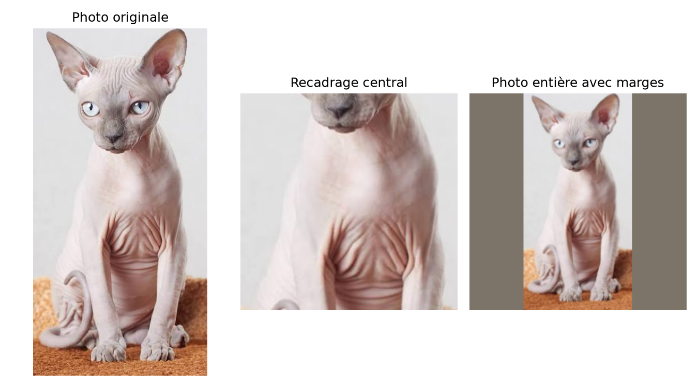

# Réentraînement pour généraliser à de nouvelles photos

## Besoin du refuge

Le refuge traite généralement une photo une seule fois. La fonction principale
doit donc améliorer les prédictions sur de nouveaux animaux et de nouveaux
cadrages. Les corrections humaines servent d'étiquettes pour les données
d'apprentissage et peuvent rectifier le lot en cours ; elles ne remplacent plus
automatiquement les sorties du modèle lors d'une nouvelle classification.

Une annotation ancienne peut rester visible dans le formulaire pour éviter de
ressaisir une information, mais les compteurs et la catégorie retenue d'un
nouveau lot reposent sur l'inférence réelle. L'historique des annotations reste
conservé pour la traçabilité.

## Diagnostic initial

Le premier modèle obtient 98,23 % d'exactitude et 97,97 % de F1 macro sur la
validation globale. Parmi les 20 photos de sphynx de cette validation, il classe
correctement **17 images**, soit **85 %**. Le problème ne se limite donc pas à
la photo corrigée. L'entraînement contient déjà 80 sphynx.

La photo `images (15).jpeg` a été annotée Chat par la personne responsable du
projet. Le modèle initial prédit Chien à 54,07 %. Son recadrage central enlève
les yeux et les oreilles. Cette photo constitue maintenant une donnée de
développement : sa réussite future ne pourra pas être présentée comme une mesure
de généralisation sur une image inconnue.

## Variante de prétraitement

La variante `letterbox` conserve l'intégralité de la photo et ses proportions :

```text
facteur = min(224 / largeur, 224 / hauteur)
image redimensionnée pour tenir dans 224 × 224
centrage sur un fond RGB (124, 116, 104)
conversion en tenseur et normalisation ImageNet
```

Les marges complètent l'espace restant ; aucun bord de la photo n'est retiré.
Le retournement horizontal de probabilité 0,5 reste actif à l'entraînement.
La validation et l'inférence sont déterministes. Les paramètres de prétraitement
sont sauvegardés avec le modèle et rechargés par l'application pour éviter
d'utiliser le recadrage de l'ancienne version avec les nouveaux poids.

Le premier contrôle, avec les anciens poids et seulement ce nouveau
prétraitement, donne **96,88 % d'exactitude globale**. Préserver toute l'image
n'améliore donc pas automatiquement la performance du classificateur existant.
Le réentraînement vise à adapter ses paramètres à ces représentations.

## Expérience séparée

Le candidat `full_frame_feedback_v1` part du checkpoint `first_run` :

- 2 944 photos d'entraînement Oxford inchangées, dont 80 sphynx.
- 1 photo externe corrigée, exportée dans `data/feedback/export_01`.
- 736 photos de validation inchangées, dont 20 sphynx.
- 3 époques avec Adam, taux d'apprentissage 0,0001 et lots de 32.
- Extracteur et statistiques BatchNorm gelés ; classificateur entraînable.
- CPU avec 4 threads, graine 42.

Le taux est plus faible que pour le premier entraînement afin de poursuivre
l'adaptation à partir de paramètres déjà appris. Les nouveaux exemples sont
mélangés aux données d'origine, au lieu d'entraîner uniquement sur l'erreur
signalée. L'export est vérifié avant son ajout : empreintes, labels humains,
chemins et absence de recoupement exact avec les partitions Oxford.

Commande exécutée :

```bash
python scripts/train.py --run-name full_frame_feedback_v1 \
  --preprocessing letterbox \
  --init-checkpoint models/first_run/best_model.pt \
  --feedback-dir data/feedback/export_01 \
  --learning-rate 0.0001 --epochs 3
```

Un dossier d'expérience existant n'est jamais écrasé. Pour reproduire, choisir
un autre `--run-name`. Le premier checkpoint reste conservé comme référence.
Le meilleur checkpoint du candidat est sélectionné sur sa perte de validation
parmi les trois époques entraînées. Le contrôle avant entraînement est conservé
séparément.

### Résultat de la variante avec marges

L'expérience `full_frame_feedback_v1` est terminée. Elle atteint **97,28 %
d'exactitude globale**, **96,92 % de F1 macro** et reconnaît **19 sphynx sur 20**.
Elle améliore ce sous-groupe, mais régresse globalement par rapport à `first_run`.
Les critères de remplacement ne sont donc pas satisfaits : ce modèle n'est
pas activé dans l'application.



L'image ci-dessus sert au diagnostic. Elle a été utilisée pour entraîner les
candidats et ne constitue pas une observation indépendante de généralisation.

### Second essai conservant le cadrage d'origine

Un second protocole, `refined_feedback_v1`, conserve le recadrage et les
augmentations d'origine. Il poursuit l'entraînement depuis `first_run`, avec
les mêmes 2 944 photos Oxford, l'exemple humain ajouté, trois époques et un taux
de 0,0001. Cela permet de comparer une modification plus conservatrice au
changement de prétraitement, sans modifier les partitions réservées.

```bash
python scripts/train.py --run-name refined_feedback_v1 \
  --preprocessing center_crop \
  --init-checkpoint models/first_run/best_model.pt \
  --feedback-dir data/feedback/export_01 \
  --learning-rate 0.0001 --epochs 3
```

Ses critères de remplacement sont identiques et ont été enregistrés dans
`results/comparisons/refined_feedback_v1/protocol.json` avant ses résultats.
La comparaison complète utilise :

```bash
python scripts/compare_runs.py --baseline first_run \
  --candidate refined_feedback_v1 \
  --probe-photo "vraies photos/images (15).jpeg"
```

### Comparaison finale et modèle activé

| Modèle | Exactitude globale | F1 macro | Sphynx reconnus en validation | Décision |
|---|---:|---:|---:|---|
| `first_run` | 98,23 % | 97,97 % | 17/20 | Référence conservée |
| `full_frame_feedback_v1` | 97,28 % | 96,92 % | 19/20 | Non activé : régression globale |
| `refined_feedback_v1` | **99,05 %** | **98,91 %** | **18/20** | **Activé** |

Le modèle retenu est celui de l'époque 3 du second essai, sélectionné selon
sa perte minimale (0,0283). L'époque 2 atteint une exactitude légèrement supérieure
(99,18 %), mais son critère de sélection reste la perte, comme annoncé.
La boucle d'entraînement/validation du second essai dure environ 6 min 50 s.

Le modèle actif est `models/refined_feedback_v1/best_model.pt`, configuré dans
`config.py`. L'activation et les empreintes sont consignées dans
`results/model_activation.json`. Le premier modèle n'est pas écrasé et la variante
avec marges reste un résultat expérimental non activé.

Sur la validation globale, les erreurs passent de 13 à 7. Les chats correctement
reconnus passent de 229/238 à 233/238, les chiens de 494/498 à 496/498. Le gain sur
les sphynx correspond à une image de validation supplémentaire ; deux erreurs
subsistent dans ce sous-groupe.

La photo corrigée est maintenant prédite Chat à 65,43 % par le réseau, sans
remplacement par son annotation historique. Comme elle a servi à entraîner, cette
réussite est un contrôle de développement, pas une mesure indépendante.
Le parcours Streamlit vérifie l'origine **Modèle** dans le tableau ; le détail
est conservé dans `results/interface/verification_modele_actif.json`.

## Décision de remplacement

Le protocole a été enregistré avant la fin de l'expérience dans
`results/comparisons/full_frame_feedback_v1/protocol.json`. L'activation locale
du candidat exige simultanément :

1. Un F1 macro global au moins égal à celui de la référence.
2. Une exactitude globale au moins égale à celle de la référence.
3. Un rappel strictement supérieur sur les sphynx de validation.

La comparaison utilise les mêmes identifiants et étiquettes pour toutes les
prédictions ; une omission d'images est refusée. Les résultats par race portent
toujours sur la classification Chat/Chien à l'intérieur de chaque groupe de race.
Ils ne mesurent pas une prédiction de race.

```bash
python scripts/compare_runs.py --baseline first_run \
  --candidate full_frame_feedback_v1 \
  --probe-photo "vraies photos/images (15).jpeg"
```

Les résultats chiffrés de comparaison sont dans
`results/comparisons/full_frame_feedback_v1/comparison.json` et
`per_breed_comparison.csv`. Le contrôle de la photo corrigée est présenté
séparément comme exemple de développement utilisé dans l'entraînement.

## Limites de l'expérience

Le test officiel n'est pas consulté. Les 20 sphynx de validation constituent
un petit groupe ; même une réussite totale ne garantirait pas le classement
correct de tous les futurs sphynx. De nouveaux exemples de refuge, annotés et
jamais utilisés pour entraîner ou choisir le modèle, resteront utiles pour
évaluer le comportement en situation réelle.

Cette expérience change le prétraitement, poursuit l'entraînement et ajoute
une correction. Elle ne permet pas d'attribuer à cette seule correction tout
écart de performance. Le contrôle préalable isole le changement de prétraitement
sans réentraînement, mais pas les contributions individuelles de tous les facteurs.

Les comparaisons servent au développement. L'évaluation finale devra utiliser
le test indépendant après les décisions techniques, sans adapter le modèle
d'après ses résultats.

## Notions à expliquer

- Généralisation sur de nouveaux exemples et mémorisation d'un fichier.
- Effet du cadrage et cohérence entre prétraitement d'entraînement et d'inférence.
- Poursuite d'un entraînement depuis un checkpoint.
- Réutilisation de corrections humaines comme données supervisées.
- Comparaison globale et analyse d'erreurs par sous-groupe.
- Protection de la validation et du test, et limites d'un petit effectif.

Références : [PyTorch, apprentissage par transfert](https://docs.pytorch.org/tutorials/beginner/transfer_learning_tutorial.html)
et [Torchvision, redimensionnement](https://docs.pytorch.org/vision/stable/generated/torchvision.transforms.Resize.html).
